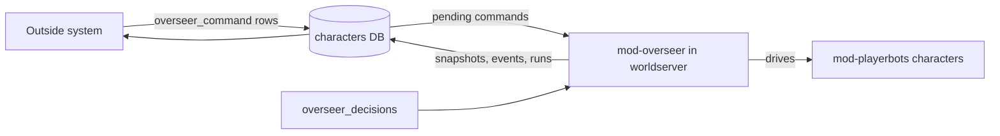

# mod-overseer

An AzerothCore module that gives mod-playerbots characters a control plane.

It lets an outside system (a chat bot, a web dashboard, a script) drive named
bot characters through rows in the `characters` database, without touching the
[mod-playerbots](https://github.com/mod-playerbots/mod-playerbots) source. It
is for operators of an AzerothCore server with mod-playerbots who want bots
that can be told what to do and that report what they did.

## What it does

1. An outside system writes a row to `overseer_command` naming a character and
   a command: quest aiming, travel, professions, materials, party leadership,
   job scheduling, dungeon and raid runs, and more.
2. The worldserver picks the row up, carries the command out through the bot,
   and marks the row `delivered` or `error` with a detail line.
3. The module writes back what the world looks like: presence snapshots
   (`overseer_snapshot`), deaths, events, dungeon run records and loot
   decisions, in `overseer_*` tables an outside page can read.

`overseer_zone_danger` holds the routing rule's current result for each online
roster member, replaced alongside presence snapshots and expired after logout.
It includes party/map context, scores and counted deaths; the existing `state`
probe carries the same projection. Consumers read this result rather than
reimplementing the danger rule.

## Quick start

There is no standalone build: the module compiles inside an AzerothCore
worldserver, next to mod-playerbots. From a core checkout at the pinned SHA in
`realm-pins.env`, with mod-playerbots already in `modules/`:

```sh
git clone https://github.com/quadseven/mod-overseer.git modules/mod-overseer
git -C modules/mod-overseer checkout <commit-sha>
bash modules/mod-overseer/apply-patches.sh "$PWD"
```

Then configure and build AzerothCore as usual. Pin the module by commit SHA,
not a branch: `main` moves. A compile is not proof it works, so check a world
actually runs on a new pin before trusting it.

## How it works



| Part | What it owns |
|---|---|
| `include.sh` | The entry point. The core's build globs `modules/*/` and finds the module through it. |
| `src/mod_overseer.cpp` | The module: the scripts hooked into the worldserver, the command poll, and the writes back. |
| `src/overseer_decisions.{h,cpp}` | The pure decisions. They include only the C++ standard library, so tests compile them with no core behind them. |
| `src/overseer_core_compat.h` | The seam between the module and core or playerbots APIs that move between pins. |
| `src/overseer_disenchant*.h` | Reagent inventory proof and the prepared, queued disenchant command store. |
| `data/sql/characters/base/` | Dated migrations against `characters`, applied in filename order by the core's `dbimport`. Each is guarded, so an older schema degrades rather than crashing. |
| `patches/`, `apply-patches.sh` | Small patches to the pinned core and mod-playerbots, applied at build time with zero fuzz. `patches/README.md` explains the mechanics. |
| `realm-pins.env` | The one copy of the pinned core, mod-playerbots and module SHAs that CI builds against. |

Patches are a real build dependency, not just source. For example,
`azerothcore-wotlk/0001-send-cast-result-hook.patch` supplies the cast
failure hook the module records. Query recent failures with:

```sql
SELECT character_name, subject_id, subject_name, detail, occurrences
FROM overseer_event
WHERE kind = 'cast_fail' AND detail = 'SPELL_FAILED_EQUIPPED_ITEM_CLASS'
ORDER BY last_seen DESC LIMIT 50;
```

For mod-playerbots, `0005-wander-npc-can-be-aimed.patch` is the patch the
module's own source calls into (`NewRpgInfo::WanderNpc::npcEntry`,
`ChangeToWanderNpc(entry, pos)`); upstream mod-playerbots has neither. If a
pin bump makes a patch stop applying, upstream has often merged the same fix:
delete the patch, or rebase it (see `patches/README.md`).

Dungeon finder returns can place members on their original continents. An
exit and reset evacuation finish when every visible member has left the source
dungeon map. Entry still requires the destination dungeon and the leader's
copy.

When walking out of a dungeon fails, the hearth recovery keeps the original
run state. Once every family member is observed outside, normal run
finalization records the outcome and advances the same campaign. An unseen
member is not proof of an exit; a member still inside remains in recovery.

A finder row may append `carry <name>` for one seated non-tank member. The
member follows the dungeon tank with attack and spell actions suppressed in
both AI engines; ordinary rows retain their existing seat behavior. Companions
are temporarily unsummoned through the core while carrying. Permanent pets
retain their saved state and are resummoned through the core on return; temporary
summons are dismissed rather than recreated. The command row retains the carry
name when a run is adopted after a restart. Only passive strategies added by
the run are removed on exit; disconnected members are restored on reconnect.

### Disenchanting a carried item

A `disenchant` command names one enabled roster character on `job='craft'`.
Reserved items are excluded, and reservations are checked again before source destruction.
The executor selects a carried, soulbound uncommon item its owner cannot use
and has sufficient Enchanting skill to disenchant. The core casts spell 13262
at that item and generates its ordinary disenchant loot. The loot hook stores
the reagents; a later poll verifies every rolled count in the bags and the
source item's removal before marking the command `delivered`. Temporary
refusals keep the command `claimed` with a reason for its next attempt.

The command store uses bound prepared statements and an asynchronous worker,
with a separate startup connection using the existing character-database
configuration. The general command drain leaves this kind to that store.
This carried-item executor is separate from the group-loot roll setting below.

## Run and test locally

The pull request gate `.github/workflows/check.decisions.yml` runs one
command from the repo root with the runner's own `g++` and `python3`, the same
command `.loom/validation.conf` runs:

```sh
bash scripts/check-locally.sh decisions
```

It checks that the two version strings agree, runs the Python replays, then
compiles `src/overseer_decisions.cpp` once and links and runs each
`tests/test_*.cpp` against it. The MySQL migration replay runs only when
`OVERSEER_MYSQL_REPLAY=1` (CI sets it beside its MySQL service);
`bash scripts/check-locally.sh schema` runs it on its own.

The main-tank replay applies the carried playerbots patch to pinned source
fixtures and compiles the actual cache and threat-consumer path. It needs git
and a C++17 compiler; it uses no realm, database or network.

The door-floor replay compiles the actual door-height adapter, route adapter
and pure trigger decisions against fixed map and navigation readings. Its
Razorfen Downs fixture models a surface above the routed floor. It requires
a C++17 compiler, without client map files, a realm or a database.

The long-navmesh replay compiles the actual route planner, walking adapter,
door census and crossing loop. Its explicit navigation boundary records the
native smoothing-buffer refusal and the corner prefix measured on that route.
Every selected leg must pass the ordinary mover's path check. Sphere and
rotated-box crossings use the actual containment decision, including a member
on the wrong floor. The session boundary refuses crossings outside the trigger.
This replay needs a C++17 compiler and does not include client map data. Live
walking and repeated campaigns still require realm verification.

The bag-purchase replay executes the actual buy preflight, packet dispatch
and inventory readback against explicit inventory and session boundaries.
It checks a full backpack with an empty bag position, refusal cases, and
the existing ordinary storage path. Native adapter CI checks the SDK calls;
live vendor purchases still require realm verification.

The family-run replay compiles the actual ledger adapters against SQLite.
It needs the SQLite development library as well as a C++17 compiler. It checks
independent families on one map, repeated members, adoption, ownership after
one run ends, and the older single-family schema behavior.

The disenchant replay runs through `test_disenchant_adapter.cpp` in the same
test loop. It compiles the actual drive, loot adapter and prepared command SQL
against a controlled core API boundary and a real isolated SQLite ledger.
It checks asynchronous ownership, unchanged inventory after accepted calls,
cast and storage refusals, release and acknowledgement retries, and queue
fairness. It needs a C++17 compiler and SQLite development files. Native SDK
compilation and a realm's item-to-reagent result remain separate evidence.

The family ledger migration keeps one active row per family and map. An active
legacy row is adopted only when its complete recorded membership identifies
one family; its current leader can have changed. Mixed or incomplete rows keep
their blank legacy scope and expire normally. Historical outcomes and roster
campaign counters are not rewritten. Stable campaign counters across borrowed
leadership remain separate work in the outside bridge.

CI also runs the actual migration twice on a fresh MySQL 8.4 service. Locally,
`scripts/check-locally.sh schema` runs that test against an isolated MySQL
server. `MYSQL_REPLAY_COMMAND` can supply a JSON array of client arguments,
such as `["docker","exec","-i","your-test-mysql","mysql","--user=root"]`.
The test uses only its `overseer_run_family_replay` fixture database. It checks
different column collations, conservative adoption, index replacement,
idempotent reapplication, and native MySQL upserts. The same suite checks the
zone-danger snapshot migration twice, its JSON replacement and explicit collation.

`scripts/check-locally.sh decisions` runs the same steps (plus the check that
`VERSION` matches the constant in `src/overseer_decisions.h`) in a scratch
folder. `scripts/check-locally.sh adapter` mirrors
`.github/workflows/check.adapter.yml`, which compiles `src/mod_overseer.cpp`
against the pinned core; it needs clang, cmake, ninja and the core's build
packages. The full build in `.github/workflows/build.yml` runs on `main`, not
on a pull request.

## Configuration

Every key is optional and has a compiled default, so a worldserver that has
never seen `conf/mod_overseer.conf.dist` behaves exactly as one that copied it
unedited. Copy it to `mod_overseer.conf` in the worldserver's module config
directory and uncomment a line only to disagree with a default. The core does
not fall back to the `.conf.dist`: without the copy, the worldserver logs a
missing-file line and the module runs on its defaults.

| Group | Keys under `Overseer.` | What it decides |
|---|---|---|
| Guild recruiting | `Recruit.*` | Target guild size and the level range it recruits in. |
| Raid shape | `Raid.*` | Tank and healer seats, the repair floor, and the catch on `guild raid form`. |
| Clients | `RequireClient`, `HeadlessRoster` | Whether roster characters need a client, and which are played headless. |
| Recovery | `Recovery.*` | When a run that cannot get in opens the summon rung, and who summons. |
| Group finder | `DungeonFinder.Default`, `GuildFinder.*` | Whether runs queue through the dungeon finder. |
| Travel | `FarWalk.*`, `Route.*`, `PartyWalk.*`, `Cross.*`, `Hunt.*` | How many long walks, crossings and hunts run at once, and route safety. |
| Leader intent | `LeaderIntent.*` | Whether rules that move a family leader go through one intent book. |
| Roster | `Natural.*`, `Rename.*`, `Retire.*` | Irreversible naturalize modes, offline renames, and the guilds a retire keeps. |
| Housekeeping | `ShareRetention.Enable` | Whether answered share rows are pruned (off by default). |

Each key is documented in `conf/mod_overseer.conf.dist`. Everything else is
worked out from the database when it is needed, so it is not a setting.

No default names one deployment's guilds or characters. `Retire.KeepGuilds`
defaults to empty, which keeps no guild beyond `Natural.Guilds`. The chat watch
list, `overseer_chat_watch`, ships empty: it is an outside write, filled by
whatever system relays the chat (one row per watched character, with the
channels to record), and the module only reads it.

One setting the module reads belongs to mod-playerbots:
`AiPlayerbot.LootRollDisenchant` (`Playerbots.LootRollDisenchant` after the
playerbots config rename). Set to 1, a weapon or armour drop the loot council
gives nobody is disenchanted by the family's Enchanter, while everybody else
passes. Left at 0, everybody greeds such a drop.

The worldserver may also set `OVERSEER_REALM`, `OVERSEER_REALM_KIND` and the
`OVERSEER_PIN_*` environment variables. The module writes them into its build
report at startup; none is required.

What does not ship here: an AzerothCore server with mod-playerbots, its MySQL
databases, and whatever outside system writes commands and reads the tables.

## Status

Last checked 2026-11-07, against `main` at the time of writing. Open work is
tracked in the epic
[a living family: gear up in Deadmines, then live off the world, part 2](https://github.com/quadseven/mod-overseer/issues/1197).

Two labels are used on every line below. **In code** means merged to `main`
with a unit test under `tests/` that fails without the change, and nothing
more: the module ships inside a worldserver, so a merge reaches a realm only
after a roll. **Seen live** means a merged pull request or ticket records
proof from a realm's logs or tables. Many merged fixes still carry the
`awaiting-live-check` label, which means no such proof has been recorded yet.
Treat the section as a dated snapshot, not a promise; the label queue is the
current truth.

### What works

- **Dungeon runs end instead of looping** (in code). A run now gives up with
  a named reason where it used to wait forever: a Zul'Farrak pyramid event or
  walk to the final boss that makes no progress ends the run so its members go
  free (#1397); a guild finder run that clears every boss ends complete, not
  stalled (#1350); a run whose dungeon module stopped on all bosses cleared
  also ends complete (#1328). Zul'Farrak, Stratholme and Upper Blackrock
  Spire have their own door, yard or step handling. Cleared Zul'Farrak runs
  were seen live (the measurements in #1397); the new give-up clocks were not.
- **A stuck combat flag is released** (in code). A character, or a family
  member frozen far from its party, that stays in combat for ten minutes with
  no hostile in reach is taken out of combat the way a player leaves it
  (#1394). Outdoor combat no longer blocks a dungeon reset (#1387); the entry
  barrier still waits for a fight near the party to end. The visible result:
  a family no longer sits at a reset for hours. Live proof is pending (#1390,
  #1399).
- **Families keep together across the ocean** (in code). A family bound wholly
  on the other continent is rebound near the door, and the exit hearth never
  crosses the ocean (#1398). A named campaign home serves only its own faction,
  so an Alliance family is not walked into Kargath, a Horde inn (#1401).
  Family mages open portals to capitals instead of walking (#1281). Live proof
  is pending (#1388, #1400, #1161).
- **Ghosts find a safe spirit healer** (in code). A ghost with no safe
  graveyard in its corpse zone walks to one beyond it, never onto the other
  faction's ground (#1402), and a guild member stuck alive at zero health now
  dies and is released (#1379). Live proof is pending.
- **Errands that used to stall** (in code). A grouped follower with full bags
  may take its sale walk (#1396). A meeting walk can hold a walker at the
  spawn for the others with `walk-to-spawn stay:<seconds>` (#1403). A bag is
  bought straight into an empty bag position (#1279). The mailbox visit
  survives consecutive attachment sends (#1302).
- **Raid run door** (in code). A `raid:ubrs` job has an Upper Blackrock Spire
  door for one guild's ten seats (#1310). It has not been seen live.
- **Breadth of commands** (in code). The command poll handles auction, bank,
  bind, buy, cast, conjure, give, guild, hearth, job, mail, quest, repair,
  sell, share, summon and trade rows, plus the prepared `disenchant` command
  described above.
- **Internal structure** (in code). The rule for who holds a character's
  movement sits behind one interface (#1380). The decisions suite builds every
  `tests/test_*.cpp` against the pure decision code with no realm.

### What does not work yet

- **Disenchanting has not been seen to work.** The first version logged a
  disenchant queue error at every start because of a collation mismatch. The
  fix is merged (#1365) and unconfirmed (#1364). No realm has recorded a
  disenchant yet.
- **Nothing in the lists above is proven live** except where a line says so.
  The queue of `awaiting-live-check` tickets is large; read it before relying
  on any behavior.
- **Known open bugs.** Eleven dungeon doors still need a surveyed approach
  (#579), a Razorfen Downs exit aims above the routed floor (#1269), a leader
  south of Uldaman cannot reach the door (#1257), a quest take refused for bag
  room is reported as ineligible (#1393), a quest giver is reported out of
  reach just after the walk arrived (#1392), and a Blackrock Depths run does
  not yet walk the Ironfel carrier to the Shrine of Thaurissan (#1391).
- **A worldserver crash ticket is open.** A null or stale attack target in
  mod-playerbots crashed the worldserver (#1166). Patches that resolve the
  target again are merged, with no live confirmation.
- **Fishing and cooking** are tracked as not yet reliable (#530, #534).
- **The Ragnaros one-shot** is a goal, not a result (#919). The raid repair,
  straggler summon and Upper Blackrock Spire door are in code, and none has
  been seen live.
- **Structural work is proposed, not done:** a dungeon run lifecycle module, a
  shared group-run shape and a tick schedule (#1313, #1315, #1314).

## Contributing

Changes land through a pull request; direct pushes to `main`, deletion and
force-push are refused by a repository ruleset. A pull request must pass the
decisions check, the adapter compile and the leak scan. Read
[AGENTS.md](AGENTS.md) first: this repository is public.
